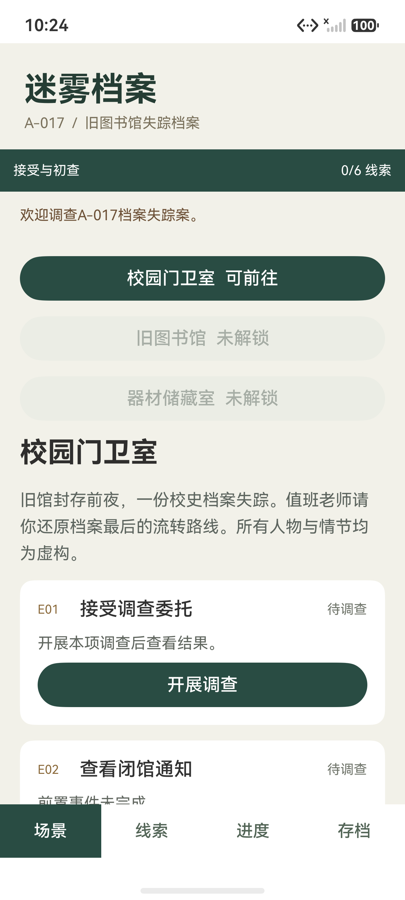
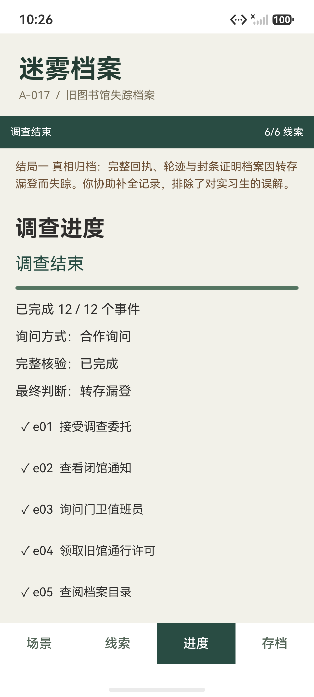
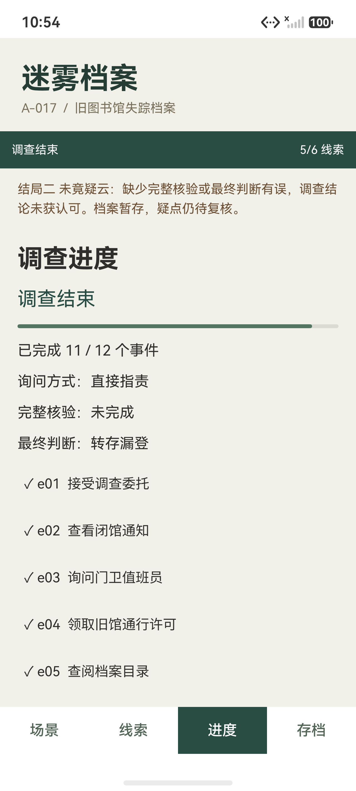
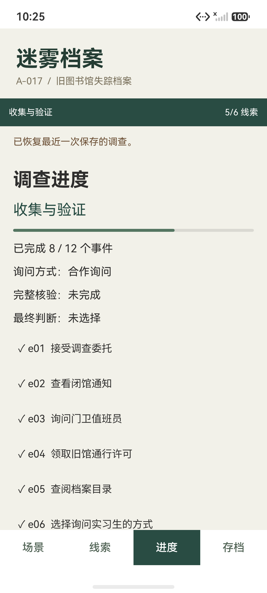

# 迷雾档案第二版

荀怡，学号20230313247，独立完成。仓库：https://github.com/Alice1332/MistArchive-v2。

需求基线在2026年11月15日提交，11月16日开始本轮实现。复用来源为[第一版3645567](https://github.com/Alice1332/-111/commit/36455675e3bfb48ce5a8bf0072c968ae86c5277c)；本仓库需求、复用基线和后续实际改进分别记录在Git历史中。

## 已完成的改进

- 未完成的事件只显示操作提示或锁定原因；调查完成后再展示结果，询问与判断前不直接展示分支后果。
- 页面使用UIContext取得宿主上下文、执行动画和弹出确认框；原生构建中原有相关弃用提示已消除。
- 新增InvestigationSession，页面与测试共享同一读档、保存、重开流程。保存失败时不发布新状态，允许重试，处理中拒绝并发提交。
- 使用独立包名com.example.mistarchive.v2，在模拟器上与第一版分开保存数据。

## 实际验证

2026年11月16日重新执行32项共享核心测试及文件Mock跨进程恢复，全部通过。第二版HAP原生编译成功，在Mate 90 Pro模拟器完成8项UI检查，包含两种结局、取消重开、调查结果展示边界和实际Preferences进程终止恢复。

首次UI流程在后半段出现hdc工具调用超时；将脚本超时上限由20秒调整为45秒后，从保留的指责路线继续完成检查。原始失败记录native-ui-attempt1-v2.json、日志native-v2-ui.log及续测日志native-v2-resume.log均保留；native-ui-results.json标记了续测。

存储故障采用测试MemoryStore注入写入、flush和读取失败，运行页面实际使用的InvestigationSession，验证不推进、重试和并发保护。没有在真实Preferences平台上制造磁盘耗尽或注入存储错误。

## 构建与运行

1. 在DevEco Studio 26.0.1.290中打开本工程，工程路径使用英文，等待OhPM与Hvigor同步。
2. 目标SDK26.0.1，最低兼容配置API12；已测SDK为26.0.1.120 Beta1、模拟器系统为HarmonyOS 7.0.0.120，API12设备尚未实测。
3. 选择entry与本地模拟器，构建并运行。应用包名com.example.mistarchive.v2。
4. [未签名调试HAP](dist/MistArchive-v2-debug-unsigned.hap)已在本地模拟器安装验证；实体手机签名及兼容性未验证。

共享测试使用Node24运行：

```powershell
node scripts/test-core.mjs
```

原生UI检查需运行中的模拟器和该测试应用的初始调查状态，会重开本测试应用进度：

```powershell
node scripts/test-native-ui.mjs
```

MIST_HDC、MIST_DEVICE、MIST_BUNDLE可覆盖脚本中的本机默认配置。Hypium入口已保留，未执行Hypium本身。

## 证据与文档

- [需求说明书](docs/软件需求说明书.md)、[开发计划](docs/开发计划.md)、[实际开发记录](docs/开发记录.md)。
- evidence/host-test-results.json：32项共享核心测试及文件Mock恢复。
- evidence/build-v2.log：原生构建结果。仍有3处Preferences异常处理提示和未配置签名提示。
- evidence/native-ui-results.json：8项原生UI结果、实际进程终止与恢复记录。
- evidence/build-v2-package.json：版本、验证范围及HAP校验值。

<p> </p>
<p> </p>

## 尚待完成

V2-04真实连续录屏与第二版个人Word报告尚未完成。当前截图及第一版报告不能代替第二版完整视频与报告。原生平台存储故障注入、实体手机和API12运行属于未验证范围。
